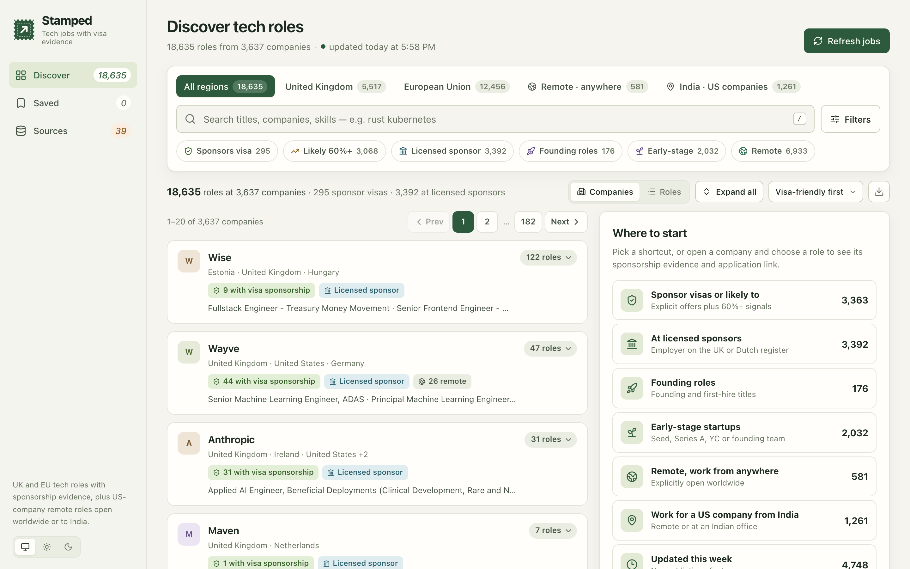
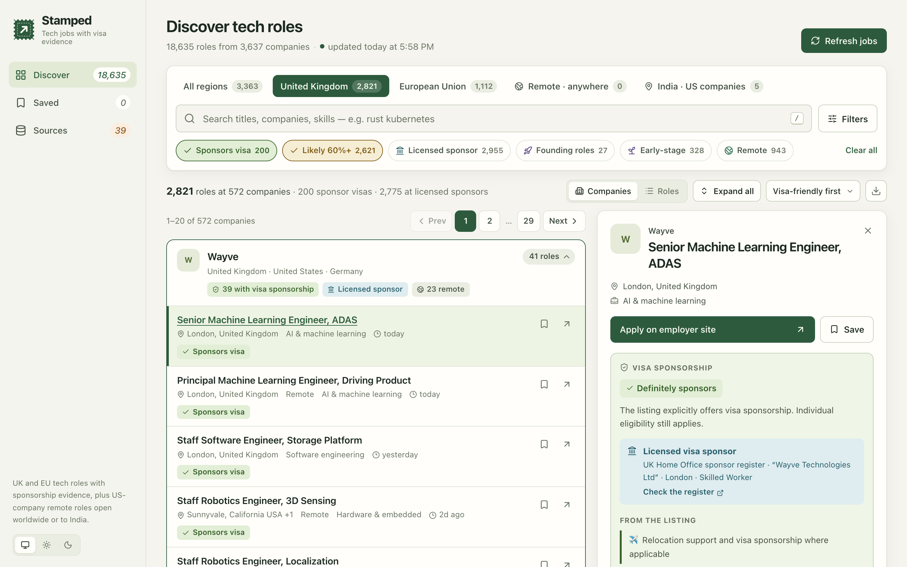
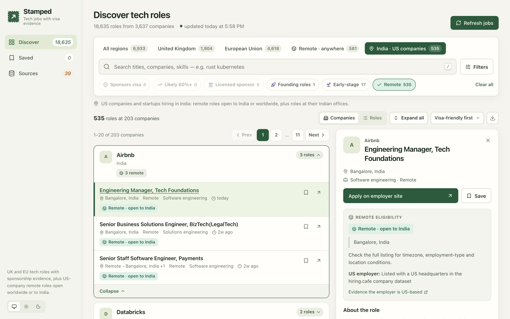
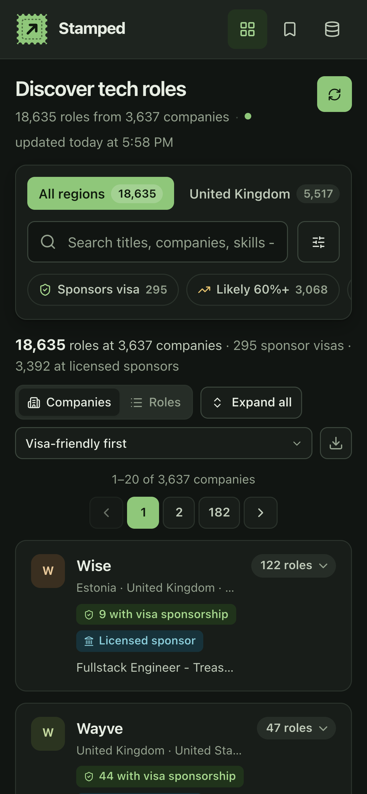

<p align="center"></p>

<h1 align="center">Stamped</h1>

<p align="center"><b>Tech jobs with visa evidence.</b><br>UK and EU roles with a sponsorship verdict for each, plus remote roles open worldwide or at US companies hiring in India.</p>

<p align="center"></p>

- **~18,600 roles from 3,600+ companies**, read from 2,500+ employer job boards (Greenhouse, Ashby, Lever, Workable, Personio, Recruitee, SmartRecruiters) and public job sites.
- **Every UK/EU role gets a verdict**: *Definitely sponsors*, *Don't sponsor*, or *Not sure* with a percentage. Each verdict shows the quoted listing text and a match against the UK Home Office or Dutch IND sponsor register.
- **Filters that combine**: Sponsors visa, Likely 60%+, Licensed sponsor, Founding roles, Early-stage, **Remote · anywhere** and **India · US companies**.
- **Runs on your machine.** No account and no AI calls; saved roles stay in your browser.

| Sponsorship evidence | Work for a US company from India | Phone, dark mode |
|---|---|---|
|  |  |  |

## Run it

Requires Node.js 20 or newer.

```bash
npm install
npm run build
npm start                 # open http://127.0.0.1:4317
```

On the first run, click **Refresh jobs** (or run `npm run scrape:tech`). A full refresh reads about 2,500 sources and takes 5–15 minutes; repeat runs are faster. The data is saved in `.local/` and is not committed.

```bash
REFRESH_INTERVAL_HOURS=24 npm start                          # refresh daily while the server runs
npm run discover:tech -- --common-crawl --crawls 2 --write   # find and verify more employer boards
```

## Using it

| | |
|---|---|
| **Tabs** | All regions · United Kingdom · European Union · **Remote · anywhere** (any employer, explicitly open worldwide) · **India · US companies** (remote roles open to India or worldwide, plus Indian offices) |
| **Chips** | Choices in the same group combine with OR (Sponsors visa + Likely), and different groups with AND (+ Founding roles) |
| **Filters** | Role family, country, sponsorship, workplace, source and company, with live counts |
| **Keys** | `/` search · `J`/`K` next/previous role · `S` save · `[`/`]` previous/next page · `Esc` close |
| **Links** | Filters are kept in the URL, so you can bookmark a search |

<details>
<summary><b>How sponsorship is judged</b></summary>

The listing text decides **Definitely sponsors** (an explicit offer) and **Don't sponsor** (an explicit refusal, or a requirement that you don't need sponsorship). Anything else is **Not sure**, with a fixed heuristic score rather than a measured probability:

| Listing text | Employer on the UK/NL register | Not found on the register |
|---|---|---|
| Nothing about sponsorship | 70% | 20% |
| Conditional sponsorship | 80% | 40% |
| Relocation support only | 75% | 35% |
| Conflicting statements | 55% | 30% |
| Existing right to work requested | 35% | 10% |

The registers are the [UK Home Office register of licensed sponsors](https://www.gov.uk/government/publications/register-of-licensed-sponsors-workers) and the [IND recognised sponsors](https://ind.nl/en/public-register-recognised-sponsors/public-register-work), refreshed at most once a day. A licence means the employer *can* sponsor, not that a particular role is sponsored. Brand names are matched to legal names (Monzo → *Monzo Bank Ltd*), and the matched entity is shown so you can check it. Other EU countries have no comparable register, so their roles keep the text-only score.
</details>

<details>
<summary><b>Remote and India filters</b></summary>

- **Remote · anywhere**: the role is remote and the listing explicitly says worldwide or "work from anywhere".
- **India · US companies**: the employer is US-based, and the role is remote and open to India or worldwide, or located in India. An employer counts as US-based when its listing names a US headquarters, a public company dataset says so, or most postings on its own job board are in the US. The detail panel shows which reason applied.
</details>

<details>
<summary><b>Sources and discovery</b></summary>

- **Employer boards** (complete public feeds): Greenhouse, Ashby, Lever, SmartRecruiters, Workable, Recruitee, Personio. The list is in `config/tech-sources.json`.
- **Job sites**: Arbeitnow, Himalayas, Relocate.me, Remotive, Jobicy, Jack & Jill, and LinkedIn's public pages (bounded and rate-limited).
- **Discovery**: `discover:tech --common-crawl` reads every ATS board URL in recent [Common Crawl](https://commoncrawl.org) snapshots and keeps a board only if its live feed has a matching role.
- A feed that fails keeps its previous listings. Copies of the same role from several sources are merged, and the employer's own board wins.
</details>

## Develop

```bash
npm test             # 79 tests
npm run typecheck
npm run validate:tech
npm run reclassify:tech   # re-run the rules on the saved data, no network
```

`tech/` holds the collectors, classifier, registers and server; `dashboard/` the React UI. Built on the scraper framework (`lib/`, `validator/`, `template/`) from [DevelopIQ-ai/jobs_db](https://github.com/DevelopIQ-ai/jobs_db); its original README is in `UPSTREAM.md`.
